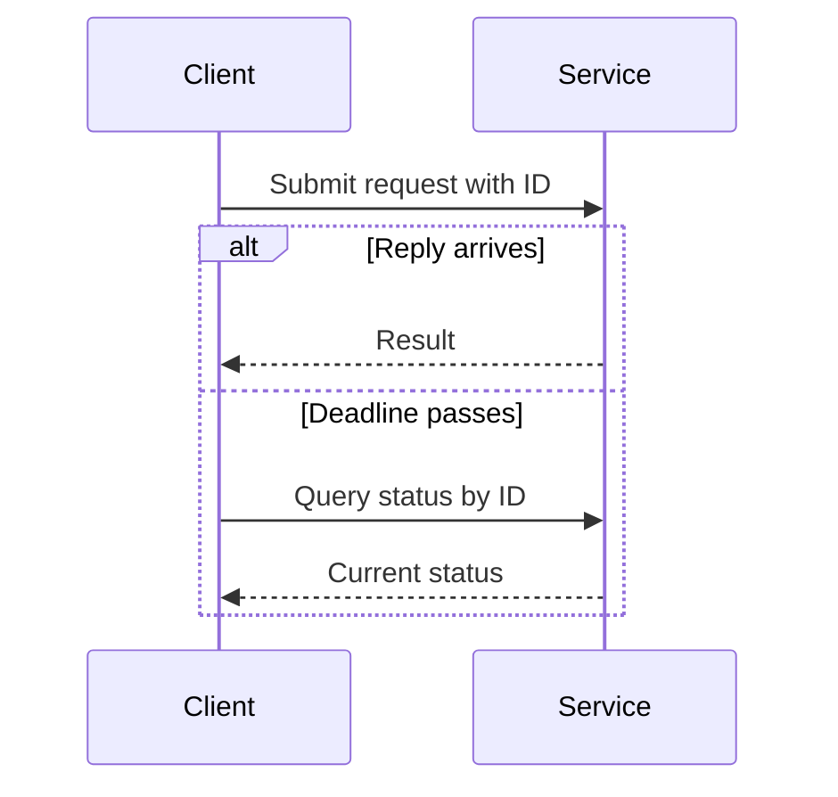
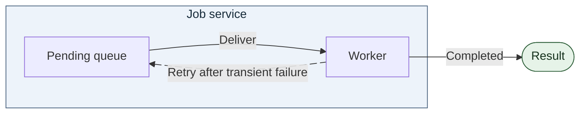
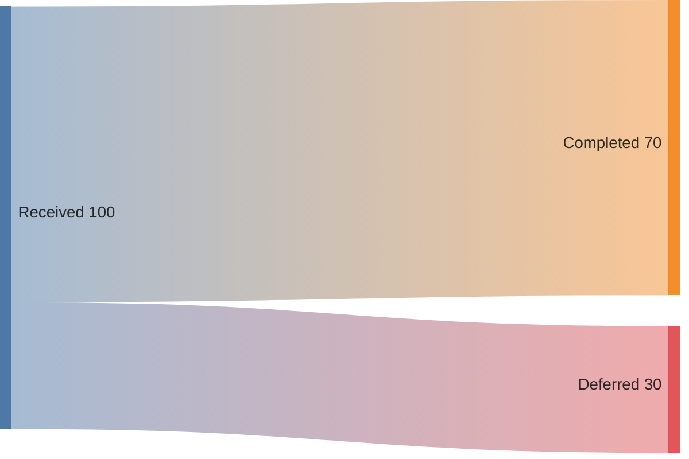
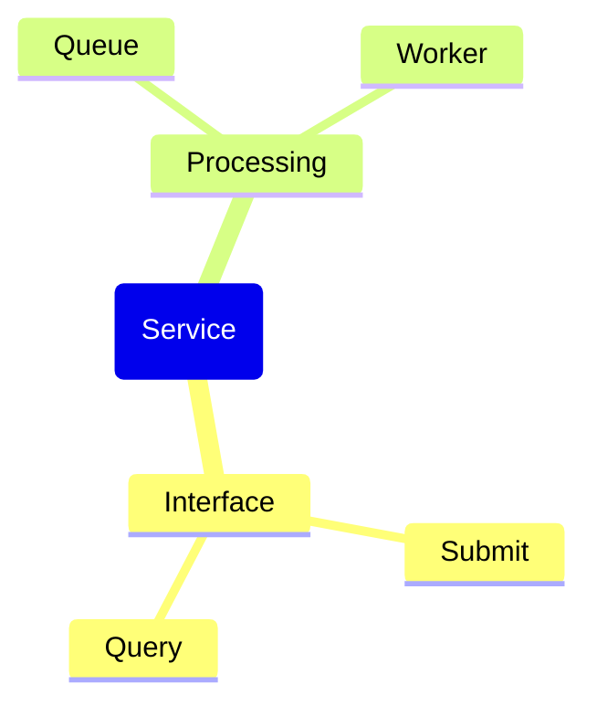

# Mermaid patterns

## Interaction across a timeout

Read from top to bottom. The timeout is an event observed by the caller; it leaves the server's completion status unknown.

## A boundary and a return path

The shaded group identifies who owns both steps. The labeled return edge shows which condition causes another attempt. On a renderer without edge IDs or motion, replace the two retry lines with `W -->|Retry after transient failure| Q`.

## Quantitative split

Illustrative counts only: 100 requests split into 70 completed and 30 deferred. Width encodes request count. Use observed values and the reporting period for a real system.

## Hierarchy without weights

Indentation means containment; reading order implies no execution order.

Verify the syntax accepted by the destination version, particularly the Sankey declaration and animated edge attributes. [Sequence diagrams](https://mermaid.js.org/syntax/sequenceDiagram.html) · [Flowcharts](https://mermaid.js.org/syntax/flowchart.html) · [Sankey](https://mermaid.js.org/syntax/sankey.html) · [Mind maps](https://mermaid.js.org/syntax/mindmap.html)
